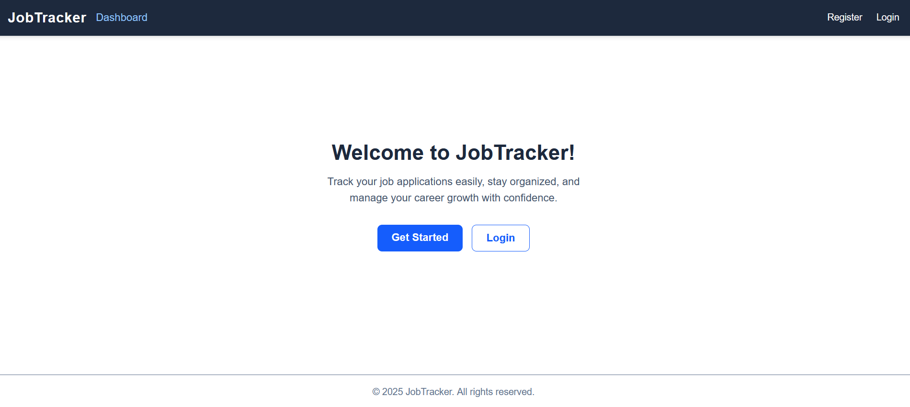
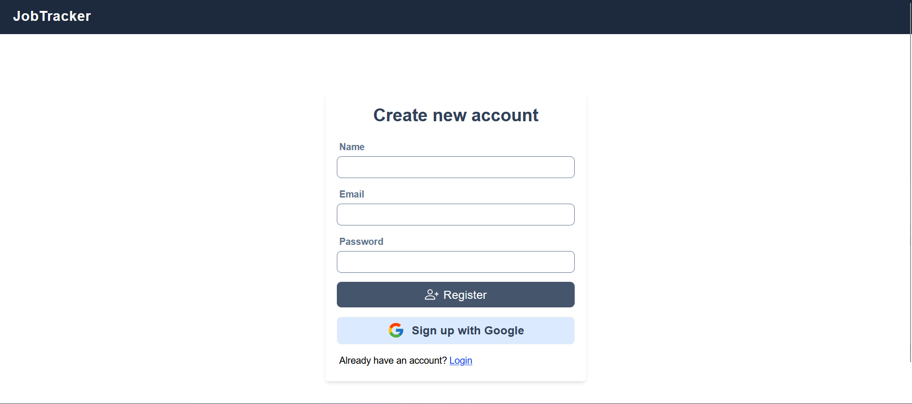
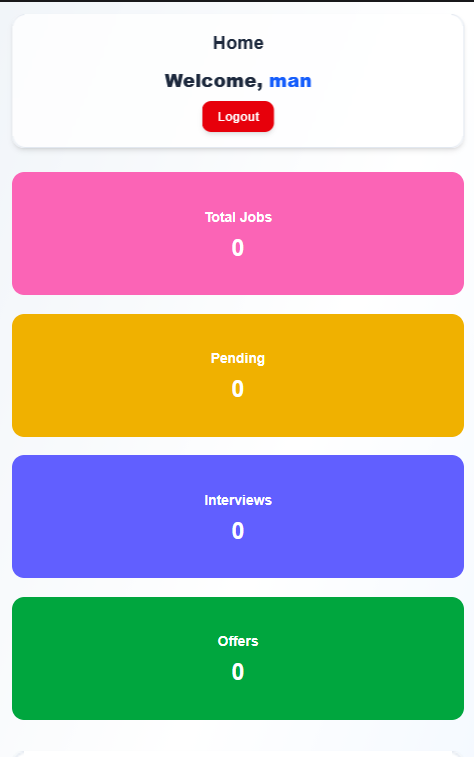
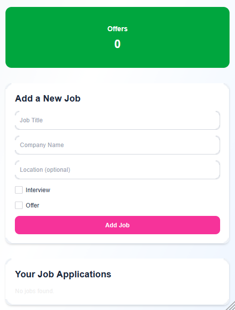
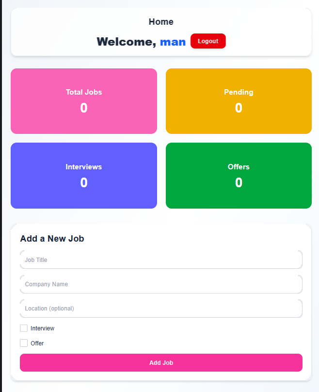
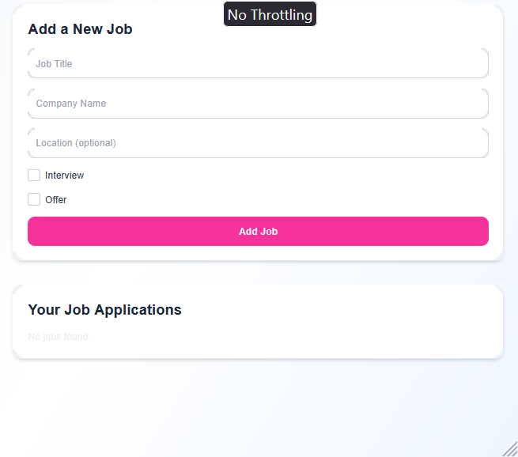
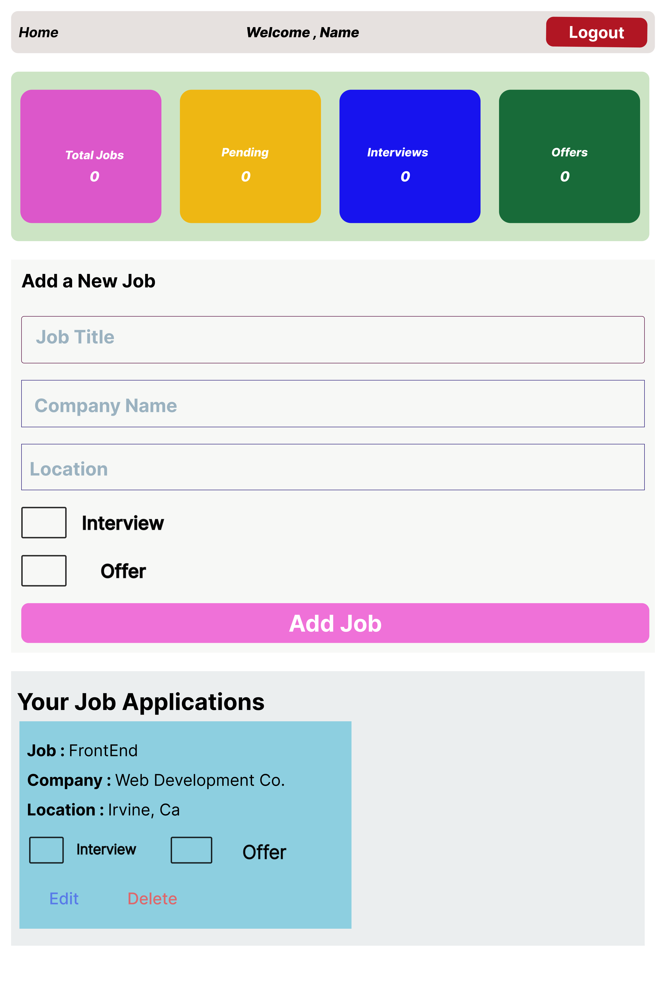

Job Tracker 🚀

Hey there! 👋 This is my Job Tracker project — a full-stack web app I built to help users keep track of job applications, manage their dashboard, and stay organized during the job hunt.

I built this project with React, Next.js, and modern front-end tools. It's also my first full-stack project where I practiced writing tests for components, which helped me get more confident with React testing.

Features ✨ :-

Add, view, and manage job applications

User authentication with Auth.js

Dynamic dashboard for easy tracking

Responsive layout for desktop and mobile

Form validation using React Hook Form

Data fetching and state management with React Query

Tech Stack 🛠️:-

Next.js – server-side rendering & routing

React – interactive UI components

React Hook Form – easy form handling with validation

React Query – fetching & managing server state

Auth.js / NextAuth – user authentication

Jest & Testing Library – basic component testing

Testing 🧪:-

I wrote basic tests to demonstrate I can:

Render forms and input fields correctly

Type into form fields

Check if the navbar displays correct links based on authentication

This helped me practice unit testing and improved my confidence with React component testing.

## 🖼️ Screenshots

### 💻 Desktop View

### 📱 Mobile View

### 📟 Tablet View

---

## 🎨 Figma Design

Before building this project, I designed the dashboard in Figma.

## Run Locally

npm install
npm run dev
